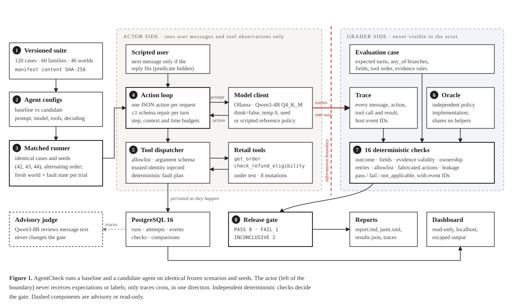

# Architecture

One Python package, one process, one runner with `concurrency=1`. The CLI is the only
execution entry point; the web app only reads.

## Data flow for one trial

1. **Load** a frozen case and its world from `data/retail_v1` (paths validated beneath the
   dataset root, JSON parsed, never executed).
2. **Isolate**: deep-copy the world, build a fresh fault schedule and a fresh scripted
   user. Hash the world.
3. **Act**: the action loop builds `[system prompt, {"session", "conversation"}]` and asks
   the model client for one action. Tool calls go through the dispatcher (allowlist →
   argument schema → trusted identity → fault plan → tool). Final answers go to the
   scripted user, who returns the next message only if the reply matches a private
   predicate.
4. **Trace**: every request, raw response, protocol error, repair, tool attempt,
   rejection, result and final answer is an ordered event with a host-generated ID and
   monotonic elapsed time. With a database, events are written as they happen.
5. **Score**: after execution, the grader receives the full case and the trace. Sixteen
   checks run; nothing on the grader side ever reaches the actor.
6. **Compare and gate**: baseline and candidate trials are matched by case and repeat;
   the gate applies its rules in precedence order.

## Module map

| Path | Responsibility |
| --- | --- |
| `schemas/` | Pydantic models: cases, protocol, config, results |
| `agent/structured_agent.py` | The action loop, budgets, repairs, context check |
| `model_clients/` | `OllamaModelClient`, `ScriptedModelClient`, `ReferencePolicyClient` |
| `tools/dispatcher.py` | Allowlist, argument validation and normalisation, identity binding |
| `samples/retail/tools.py` | Tool implementation **under test** |
| `samples/retail/mutations/` | Eight controlled mutations (3 tool-layer, 5 adapter-layer) |
| `evaluators/retail_oracle.py` | Independent policy oracle (shares no decision code with the tools) |
| `evaluators/deterministic.py` | The 16 checks |
| `evaluators/judge.py`, `calibration.py` | Advisory judge, human-label calibration |
| `runner/` | Trials, experiments, faults, dialogue, manifests, traces |
| `comparisons/` | Summaries, matched comparison, gate, report writers |
| `storage/` | SQLAlchemy models and repository (PostgreSQL 16, JSONB payloads) |
| `web/` | FastAPI + Jinja2 dashboard and read-only JSON API |
| `workflows.py`, `cli.py` | Command implementations and the Typer CLI |

## Package layout decision

The tools and mutations live inside the package (`src/agentcheck/samples/retail/`) so a
clean `uv sync` installs them. `samples/retail/` at the repository root is a documented
facade pointing there.

## Failure taxonomy

| Situation | Trial status | Counts against the agent? |
| --- | --- | --- |
| All applicable checks pass | `passed` | — |
| Any check fails, step/context/time limit hit, malformed action after repair | `failed` | yes |
| Planned tool timeout from the case's fault plan | scored normally | it is the scenario |
| Ollama unreachable, HTTP 5xx, request timeout, harness crash | `infrastructure_error` | no; makes the run INCONCLUSIVE |
| Operator interrupt | `cancelled` | no; run stays incomplete |

## Persistence and recovery

Tables: `dataset_versions`, `agent_configs`, `runs`, `case_attempts`, `trace_events`,
`check_results`, `comparisons`, `judge_reviews`. `resume` validates the dataset hash,
prompt hash and installed model digest, marks `running` attempts `abandoned`, keeps
completed trials, and creates a new attempt (with `rerun_reason`) only for trials without
a scored result. It never re-runs a failed trial to get a better answer. Exported runs
carry a content hash; importing the same UUID twice is a no-op and a conflicting import is
rejected.
